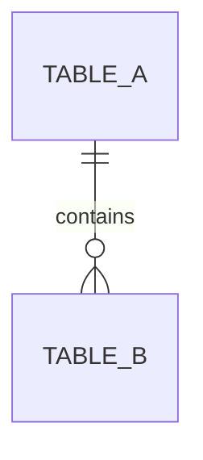

# 数据库模型文档同步

把数据库结构翻译成用户能读懂的模型文档，并在表结构变化后同步更新。这个 skill 只读数据库元数据或项目中的 schema/migration/model 文件，不执行数据写入，不修改数据库结构。

## 输出目录和文件规则

所有模型文档存放在：

```text
docs/model/
├── <table-name>.md
├── <another-table>.md
└── ER.md
```

- 一张表对应一个 Markdown 文件，文件名使用真实表名。
- 表名含空格或特殊字符时，只做文件系统安全的最小转义，并在文档中保留真实表名。
- ER 图统一写入 `docs/model/ER.md`，使用 Mermaid `erDiagram`，方便 Markdown 编辑器直接预览和后续修改。
- 不把多个表压缩到一个表文档中。视图、物化视图和中间表也要明确标注对象类型。
- `docs/model/README.md` 可作为目录索引，但不能替代一表一文档。

## 触发方式

### 主动触发

用户提到以下任务时触发：

- 整理数据库表结构
- 生成数据字典或模型文档
- 创建或更新 ER 图
- 解释表、字段、主键、外键或表之间的关系
- 把数据库结构写入 `docs/model/`

### 被动触发

在已有项目上下文中，如果发现以下变化，自动检查模型文档是否需要同步：

- 新增、修改或删除 migration
- ORM schema、model、entity、DDL 或 SQL 文件发生变化
- 数据库 introspection 结果发生变化
- 表、字段、索引、主键、外键、唯一约束或枚举发生变化
- 表名或字段名重命名

被动触发只做模型文档同步，不顺便重构业务代码，也不扩展到用户没有要求的数据库设计。

## 数据来源优先级

按以下顺序确认结构事实：

1. 用户明确指定的目标数据库只读元数据。
2. 项目当前使用的 schema 或 ORM model。
3. migration、DDL 和数据库初始化脚本。
4. 已有 `docs/model/` 文档，只能用于保留人工解释，不能覆盖真实结构。

如果数据库实时结构与代码 schema 不一致，必须同时报告两者的差异，不能选择一方静默覆盖另一方。

不要求用户把密码、API key 或数据库连接串粘贴到对话里。优先使用项目已经配置好的安全连接方式；无法读取真实结构时，明确标记“结构待确认”。

## 同步流程

### 1. 发现项目数据库入口

检查：

- 数据库类型和版本（如果能确认）
- ORM 或 schema 工具
- migration 目录和执行顺序
- 表命名约定
- 现有 `docs/model/` 内容
- 是否有只读 introspection 脚本或命令

只使用项目中真实存在的工具和命令。未发现的内容写“未发现”，不要猜测。

### 2. 计算结构差异

以表和字段为单位比较当前结构与已有文档，至少识别：

- 新增、删除、重命名的表
- 新增、删除、重命名、类型变化、可空性变化和默认值变化的字段
- 主键、外键、唯一约束、普通索引和枚举变化
- 一对一、一对多、多对多关系变化
- 关系方向、级联策略和引用目标变化

重命名只有在 migration 或 schema 中有明确证据时才确认；否则同时列为“可能删除旧字段 + 新增新字段”，要求人工确认。

### 3. 生成或更新表文档

每个 `docs/model/<table-name>.md` 至少包含：

```markdown
# <可读的数据表名称>

## 基本信息
- 真实表名：`<table-name>`
- 对象类型：表 / 视图 / 物化视图 / 中间表
- 表的作用：<基于 schema、代码和已有说明整理；未知时标记待确认>
- 数据来源：<schema、migration 或只读数据库元数据>
- 当前状态：正常 / 待确认 / 已移除

## 字段说明

| 字段名 | 可读名称 | 类型 | 可空 | 默认值 | 主键 | 外键 | 说明 |
|---|---|---|---|---|---|---|---|

## 索引与约束

## 与其他表的关系

## 数据流和使用场景

## 变更记录

## 人工补充说明
```

字段说明必须保留真实字段名，同时提供可读名称。可读名称的来源优先级是：

1. 项目已有字段注释、schema comment、数据字典或业务文档。
2. 用户明确提供的字段含义。
3. 根据字段名和调用代码做出的保守解释，并标记“推断，待确认”。

不能把字段名直译后当成确定业务含义。对于 `id`、`status`、`type`、`metadata` 等含义不充分的字段，必须写清楚证据不足。

### 4. 更新 ER 图

`docs/model/ER.md` 至少包含：

````markdown
# 数据库 ER 图

## 图例说明



## 关系说明

| 关系 | 关联字段 | 关系含义 | 证据 |
|---|---|---|---|
````

Mermaid 图中的实体名应使用数据库表名或安全别名，字段必须保留真实字段名。关系必须来自明确的外键、唯一约束、schema 定义或可靠的项目代码证据。仅凭字段名猜出的关系要标注为“推断”，不能画成已确认关系。

ER 图每次同步都要覆盖新增和删除的实体、字段和关系，避免只追加导致图中残留旧结构。

### 5. 保留人工内容

文档分为同步区和人工区：

- 同步区：真实表名、字段、类型、约束、关系、数据来源和变更记录。
- 人工区：业务解释、示例、业务负责人备注、上下游背景和未固化的假设。

更新时只重写同步区，保留人工区原文。人工区里的说明与真实 schema 冲突时，在文档中标注冲突并以真实结构为准。

## 结构变更处理

### 新增表或字段

- 创建对应表文档或更新对应表文档。
- 在 ER 图加入实体、字段和确认过的关系。
- 在变更记录中记录来源和变更时间。

### 删除表或字段

- 表文档不要静默消失；先标记为“已移除”，记录移除依据和时间。
- 字段在文档中标记为“已移除”，不要从变更记录中抹掉历史。
- ER 图中移除已经确认不存在的实体或关系，并在关系说明中保留必要的历史说明。

### 重命名表或字段

- 只有 migration 或 schema 明确声明重命名时才同步重命名文件和引用。
- 证据不足时不自动移动文件，生成待人工确认的差异。

### 破坏性变更

类型缩窄、可空改非空、删除字段、删除表、修改主键或级联策略属于破坏性变更。文档必须突出显示，并说明可能影响的代码、接口和数据迁移。

## 冲突和异常处理

- 数据库结构、migration 和 ORM schema 不一致时，输出差异清单并暂停自动覆盖。
- 无法连接数据库时，使用代码 schema 或 migration 生成“待确认”文档，不伪装成数据库实测结果。
- 无法确认表作用或字段含义时，保留真实名称并写“待业务确认”。
- 多个 schema 中存在同名表时，在文档名或基本信息中保留 schema 名，避免覆盖。
- 不执行 `DROP`、`ALTER`、数据迁移或任何写入数据库的命令。
- 不把 API 返回样例、测试 fixture 或 mock 数据当成真实数据库结构。

## 完成检查

- 是否为每张表生成了独立文档？
- 每个文档是否包含真实表名、可读名称、表作用和字段映射？
- 是否记录了主键、外键、索引、约束和表关系？
- `docs/model/ER.md` 是否反映当前已确认的表和血缘关系？
- 是否保留了人工补充内容和历史变更记录？
- 是否识别了新增、删除、重命名和破坏性变更？
- 是否明确区分了真实结构、推断内容和待确认信息？
- 是否没有向数据库执行写入或破坏性操作？
